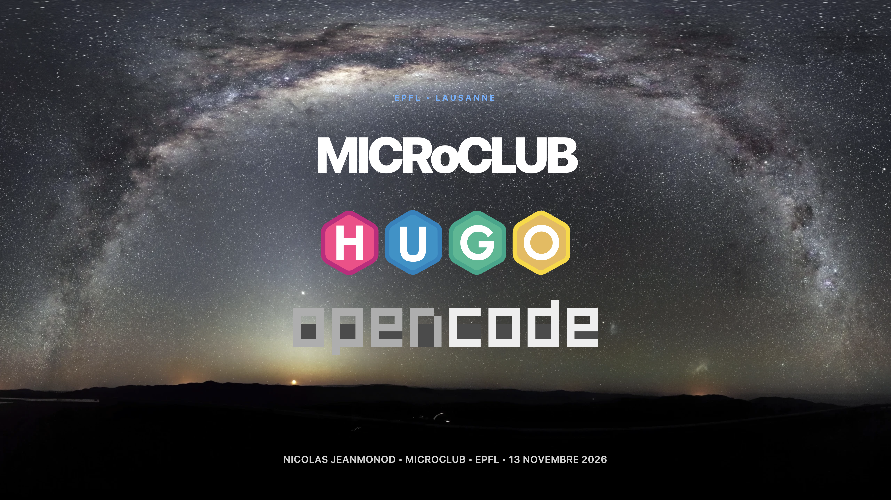
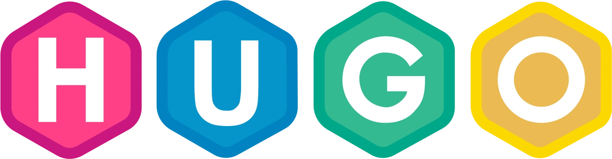
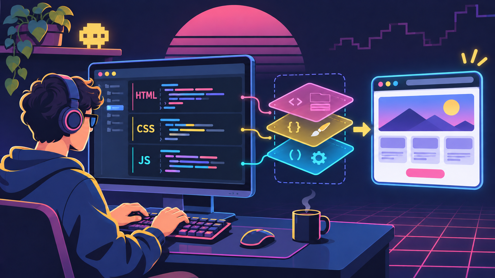
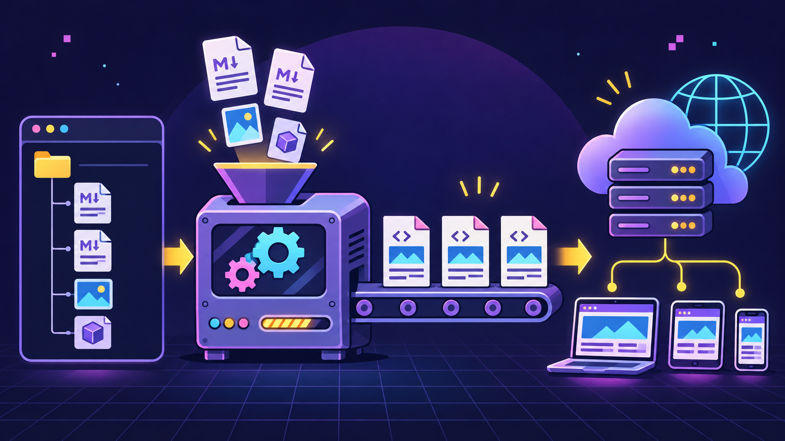
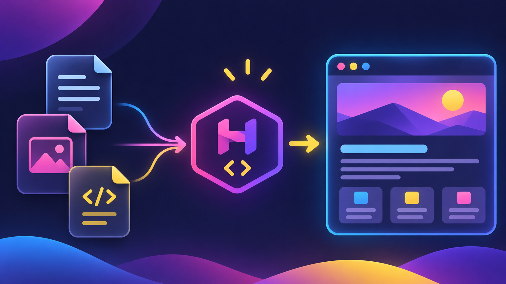
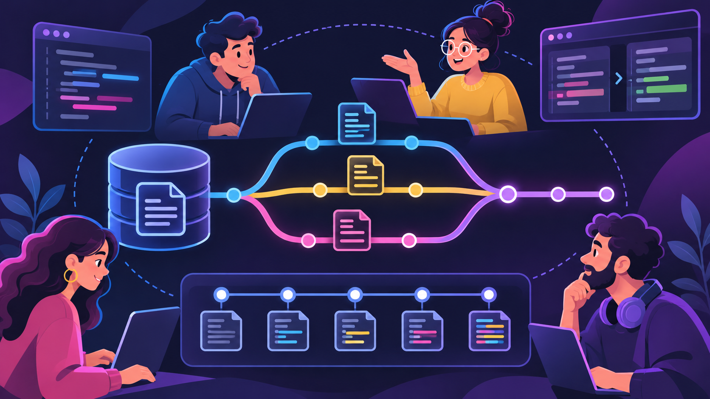

---

## MICRoCLUB




> Nicolas Jeanmonod · Microclub · EPFL · 13 novembre 2026

---


-   Hugo est un générateur de sites statiques.

---

## Quelques méthodes de génération de sites web

---

### À la main, en écrivant chaque fichier

HTML, CSS, JS



---

### Avec un constructeur visuel / no-code

Desktop : Microsoft FrontPage, Adobe Dreamweaver, Pinegrow,...

Cloud : Wix, Squarespace, Webflow, Framer,...


---

### Avec un CMS

WordPress, Joomla,...


---

### Avec un générateur de sites statiques

Hugo, Jekyll, Quarto,...



---

## Avantages d’un générateur de sites statiques

---

### Simple à comprendre et à maintenir

_Les pages sont de simples fichiers texte._



---

### Versionnable avec Git

Les fichiers texte rendent l’utilisation de Git possible :

-   versionnage
-   collaboration
-   synchronisation



---

### Rapide à générer et à servir

_Surtout avec Hugo._


---

### Peu coûteux à héberger

_Un “petit” site est hébergé gratuitement sur des forges comme GitHub._


---

### Plus sûr

Pas de base de données ni de code serveur à protéger.

_Par exemple, insensible à “php2shell” : deux failles critiques permettant l’exécution de code à distance sans authentification._


---

### Rapide à distribuer

Les fichiers sont générés à l’avance.


---

### Matrice de comparaison des méthodes

| Paramètre             | À la main                                      | Constructeur visuel /<br>no-code     | CMS                                          | Générateur de sites statiques |
| --------------------- | ---------------------------------------------- | --------------------------------- | -------------------------------------------- | ----------------------------- |
| Vitesse de diffusion  | rapide                                         | dépend de l’hébergement           | limitée par le serveur et la base de données | **très rapide**                   |
| Complexité            | élevée, nécessite des connaissances techniques | faible à moyenne                  | moyenne                                      | moyenne à élevée              |
| Base de données       | non                                            | généralement gérée par le service | souvent nécessaire                           | non                           |
| Vitesse de génération | immédiate, fichier par fichier                 | dépend du service                 | limitée par le serveur et la base de données | limitée par la durée du build |
| Pages générées        | en avance                                      | selon le service                  | à la demande                                 | en avance                     |

---

### Installation de Hugo sur Windows

Pour installer Hugo, exécutez cette commande dans PowerShell :

    winget install -e --id Hugo.Hugo.Extended

Je vous conseille aussi d’installer ces programmes

    winget install -e --id Git.Git
    winget install -e --id PedroAlbanese.QREncode

---

### Installation de Hugo sur macOS

    brew install hugo git qrencode

---

### Installation de Hugo sur Ubuntu

    sudo apt update
    sudo apt install hugo qrencode

---


---

## Les grandes catégories d’assistants IA

Du chatbot à l’agent, en très simplifié.

1. Chatbot (Assistant conversationnel)
2. Chatbot outillé
3. Agent

---

### 1. Chatbot (Assistant conversationnel)

-   Répond aux questions

#### Exemples

-   ChatGPT ¹ ²
-   Claude ¹ ²
-   Gemini ¹ ²

####

_¹ navigateur web_\
_² application desktop_\
_³ TUI (interface en terminal)_

---

### 2. Chatbot outillé

-   Fait tout ce que fait un chatbot
-   Recherche des informations
-   Utilise des applications à la demande
-   Peut modifier des fichiers

#### Exemples

-   ChatGPT avec recherche web ¹ ²
-   Claude Desktop avec MCP ²
-   Gemini avec extensions ¹

####

_¹ navigateur web_\
_² application desktop_\
_³ TUI (interface en terminal)_

---

### 3. Agent

-   Fait tout ce que fait un chatbot outillé
-   Poursuit un objectif
-   Enchaîne des actions
-   Adapte son travail selon les résultats
-   Peut vérifier ses résultats et corriger ses erreurs

#### Exemples

-   OpenCode ³
-   Codex ² ³
-   Claude Code ³

####

_¹ navigateur web_\
_² application desktop_\
_³ TUI (interface en terminal)_

---

## Les trois couches d’un système d’IA

Du prompt à l’environnement d’exécution, dans les grandes lignes.

Ces catégories forment un continuum : un assistant peut être progressivement doté d’outils et d’autonomie jusqu’à devenir un agent.

1. Prompt engineering
2. Context engineering
3. Harness engineering

---

### 1. Prompt engineering

-   Le prompt = les instructions
-   Que doit faire l’IA ?
-   Bien formuler les instructions données à l’IA

popularisé entre 2020 et 2022

---

### 2. Context engineering

-   Le contexte  = les informations disponibles
-   Que doit savoir l’IA ?
-   Fournir à l’IA les informations pertinentes au bon moment

popularisé en 2025

---

### 3. Harness engineering

-   Le harnais  = les outils, l’environnement et les contrôles
-   De quoi dispose l’IA pour travailler ?
-   Concevoir l’environnement et les outils qui permettent à l’IA d’agir efficacement
-   Prévoir les mécanismes de contrôle, de vérification des résultats et de gestion des erreurs

popularisé en 2026

---

## Pour situer ces systèmes

| Aspect                 |          Chatbot          | Chatbot outillé |         Agent         |
| ---------------------- | :-----------------------: | :-------------: | :-------------------: |
| Prompt                 |             ×             |        ×        |           ×           |
| Contexte               |                           |        ×        |           ×           |
| Harnais                |                           |        ×        |           ×           |
| Production de code     |     te donne du code      |                 | modifie tes fichiers  |
| Connaissance du projet | ne connaît pas ton projet |                 |     lit ton dépôt     |
| Mode d’interaction     |     tu copies-colles      |                 | il exécute et vérifie |
| Fonctionnement         |        une réponse        |                 |      une boucle       |

---

<!--

-
-
-
-
-
-   STOP
-
-
-
-
-
-
-

-->

<!--

## La marche du progrès de Rudolph F. Zallinger, 1965

-   <https://en.wikipedia.org/wiki/March_of_Progress>
-   <https://fr.wikipedia.org/wiki/Marche_du_Progr%C3%A8s>

Voir aussi:

> Ce qu’on a appris à l’école et qui n’est plus vrai aujourd’hui\
> Scilabus\
> <https://www.youtube.com/watch?v=rB-s51uPACc>

## Les erreurs de ces frises

-   Seuls des mâles sont représentés.
-   Certaines espèces ont évolué sans laisser de descendance et ne peuvent donc pas être représentées dans une lignée unique, mais plutôt comme des embranchements.
-   Certaines espèces ont coexisté et ont pu se reproduire entre elles.

 -->


---


---


---

## Et en 2026 ?


Le sommet de l’évolution, c’est un smartphone.

---

## Ce soir, une seule question

Comment un club de micro-informatique de 1976 fait-il son site web en 2026 ?

---

## Réponse courte

Un site statique.

Un dépôt Git.

Un agent.

Et un humain qui décide.

---

## Le site, en chiffres

| Élément         | Valeur               |
| --------------- | -------------------- |
| Articles        | 304                  |
| Médias          | 720 fichiers, 288 Mo |
| Commentaires    | plus de 300          |
| Pages générées  | 615                  |
| Build complet   | 2 secondes           |
| Base de données | 0                    |

---

## D’où l’on vient

WordPress, quinze ans d’archives.

-   304 articles
-   720 médias
-   plus de 300 commentaires
-   des URL historiques à préserver

Et une dette : mises à jour, plugins, sécurité.

---

## L’idée

Un site statique.

Des fichiers, rien de plus.

-   pas de base de données
-   pas de serveur applicatif
-   pas de mise à jour de sécurité
-   pas de mot de passe à retenir

---

## Hugo

Un générateur de site statique, écrit en Go.

-   304 articles deviennent 615 pages
-   en 2 secondes sur un laptop
-   un seul binaire
-   aucun réseau nécessaire

---

## Hugo en trois dossiers

```text
content/     les textes, en Markdown
layouts/     les gabarits
config/      les réglages
themes/      Blowfish
              ↓
public/      le site, prêt à servir
```

---

## Le contenu, c’est du texte

```markdown
## Un titre

Un paragraphe avec **du gras** et [un lien](https://microclub.ch).

- une puce
- une autre
```

Pas d’interface. Pas de base de données.

Un fichier, un article.

---

## Blowfish

Un thème Hugo.

-   responsive
-   mode sombre
-   recherche locale
-   RSS, taxonomies, i18n
-   galeries, alertes, cartes

Un thème, pas un CMS.

---

## Git, c’est la base de données

Chaque article est un fichier.

Chaque modification est un commit.

Chaque commit est une trace.

On peut revenir en arrière.

On peut relire.

On peut signer.

---

## De mon clavier à votre écran

```text
git push
   ↓
GitHub Actions
   ↓
hugo build  (2 s)
   ↓
GitHub Pages
   ↓
microclub.ch
```

Le déploiement est aussi planifié chaque nuit à minuit UTC.

---

## OpenCode

Un agent de code open source.

Il lit les fichiers.

Il lance les commandes.

Il se trompe.

Il recommence.

Dans le terminal, avec le modèle de son choix.

---

## Les UX des IA

### Prompt engineering

Bien demander.

### Context engineering

Bien informer.

### Harness engineering

Bien outiller.

---

## À regarder

> Ce que j’apprendrais à la place du Prompt Engineering en 2027.
>
> Simon De Lima

<https://www.youtube.com/watch?v=vcphkoQa_Tg>

---

## Le contexte, c’est un fichier

```markdown
# Instructions pour les agents

## Langue

- Répondre en français.
- Tutoyer.

## Typographie

- Espaces insécables avant : ; ! ? %
- Guillemets anglais “ ”
- Apostrophes typographiques ’
```

L’agent le lit à chaque session.

Ce n’est pas de la magie, c’est de la mémoire.

---

## Le harnais

Ce qui entoure le modèle.

-   des outils : lire, écrire, exécuter
-   des skills : des procédures réutilisables
-   des serveurs MCP : des connecteurs
-   des permissions : une sandbox
-   une boucle : essayer, vérifier, corriger

---

## Tous les modèles ne se valent pas

| Besoin      | Modèle | Analogie               |
| ----------- | ------ | ---------------------- |
| simple      | Haiku  | le stagiaire rapide    |
| courant     | Sonnet | le collègue polyvalent |
| stratégique | Opus   | l’expert               |
| frontière   | Fable  | l’architecte           |

On ne paie pas le même prix pour ranger des virgules que pour refactorer un site.

---

## Démo 1 — Un article

```text
Crée l’article de la conférence de vendredi.
Respecte l’archétype, les conventions de nommage
et la typographie française.
Vérifie le build avant de conclure.
```

L’agent lit `AGENTS.md`, lit l’archétype, crée le bundle, écrit le front matter, lance `hugo`, corrige, recommence.

---

## Démo 2 — La publicité animée


```sh
python scripts/animated-ad/animated-ad.py --date 2026-11-13 --format mp4
```

`agenda.yaml` → Pillow → GIF et MP4 → WhatsApp.

---

## Démo 3 — La migration

304 articles WordPress deviennent du Markdown.

720 médias.

Plus de 300 commentaires.

Des URL préservées.

Le plus dur n’a pas été le code.

C’est l’inventaire.

---

## Ce qui marche très bien

-   le contenu et sa mise en forme
-   le refactoring
-   les scripts et l’outillage
-   la documentation
-   les migrations répétitives
-   les vérifications automatiques

---

## Les pièges

-   il invente un fichier qui n’existe pas
-   il “corrige” ce qui n’était pas cassé
-   il optimise pour le prompt, pas pour le résultat
-   il oublie le contexte de la veille
-   il va vite, parfois trop vite

---

## L’IA propose. L’humain dispose

Je décide de ce qui est publié.

Je relis ce qui est écrit.

Je signe ce qui est en ligne.

---

## Combien ça coûte ?

-   un abonnement ou des jetons
-   quelques heures de relecture
-   un dépôt Git gratuit
-   un hébergement gratuit

Le poste le plus cher reste le temps humain.

---

## Ce que ça change au Microclub

-   un membre qui ne code pas peut contribuer
-   le site devient un projet collectif
-   la revue reste humaine
-   les archives restent accessibles

---

## Pour essayer ce soir

1. Installe Hugo.
2. Installe OpenCode.
3. Crée un dépôt Git.
4. Écris un `AGENTS.md`.
5. Demande un premier article.

Le reste, c’est de la pratique.

---

## Conclusion

Ce site n’a pas été écrit par une IA.

Il a été écrit par un membre du Microclub, avec une IA.

La différence, c’est la responsabilité.

---

## Questions

-   <https://microclub.ch>
-   <https://gohugo.io>
-   <https://blowfish.page>
-   <https://opencode.ai>
-   <https://github.com/NicHub/microclub>

Nicolas Jeanmonod · Microclub · 13 novembre 2026
