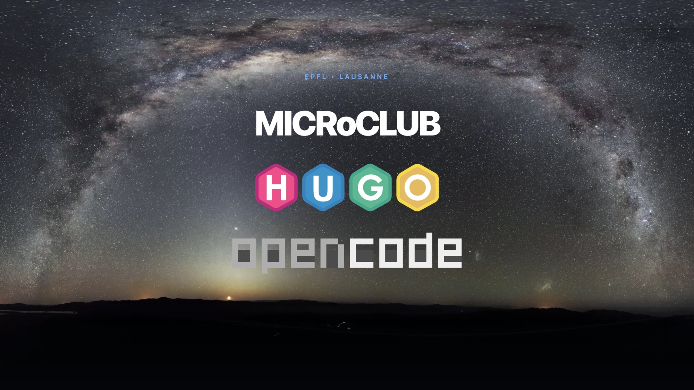
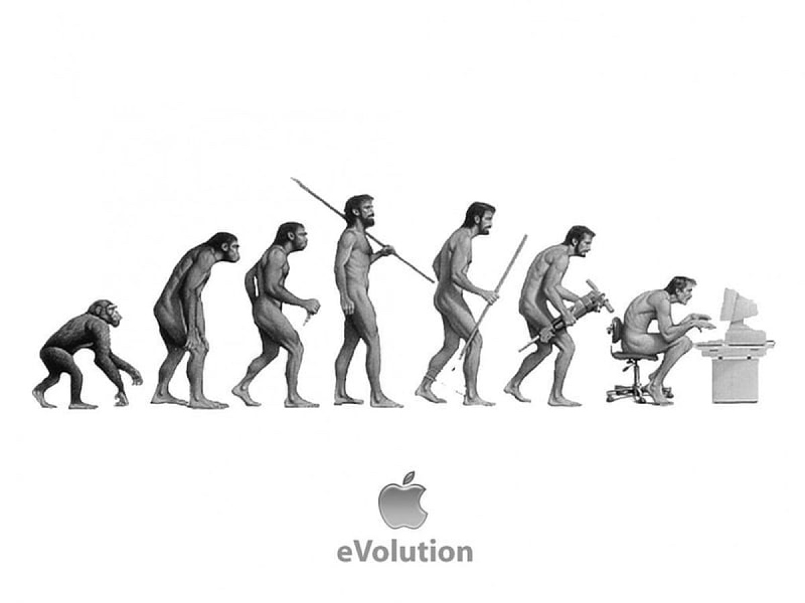

Nicolas Jeanmonod · Microclub · EPFL · 13 novembre 2026

---

---

*La marche du progrès*, Rudolph Zallinger, 1965.

---

---

## Et en 2026 ?

Le sommet de l’évolution, c’est un smartphone.

---

## Ce soir, une seule question

Comment un club de micro-informatique de 1976 fait-il son site web en 2026 ?

---

## Réponse courte

Un site statique.

Un dépôt Git.

Un agent IA.

Et un humain qui décide.

---

## Le site, en chiffres

| Élément | Valeur |
| --- | --- |
| Articles | 304 |
| Médias | 720 fichiers, 288 Mo |
| Commentaires | plus de 300 |
| Pages générées | 615 |
| Build complet | 2 secondes |
| Base de données | 0 |

---

## D’où l’on vient

WordPress, quinze ans d’archives.

- 304 articles
- 720 médias
- plus de 300 commentaires
- des URL historiques à préserver

Et une dette : mises à jour, plugins, sécurité.

---

## L’idée

Un site statique.

Des fichiers, rien de plus.

- pas de base de données
- pas de serveur applicatif
- pas de mise à jour de sécurité
- pas de mot de passe à retenir

---

## Hugo

Un générateur de site statique, écrit en Go.

- 304 articles deviennent 615 pages
- en 2 secondes sur un laptop
- un seul binaire
- aucun réseau nécessaire

---

## Hugo en trois dossiers

~~~text
content/     les textes, en Markdown
layouts/     les gabarits
config/      les réglages
themes/      Blowfish
              ↓
public/      le site, prêt à servir
~~~

---

## Le contenu, c’est du texte

~~~markdown
## Un titre

Un paragraphe avec **du gras** et [un lien](https://microclub.ch).

- une puce
- une autre
~~~

Pas d’interface. Pas de base de données.

Un fichier, un article.

---

## Blowfish

Un thème Hugo.

- responsive
- mode sombre
- recherche locale
- RSS, taxonomies, i18n
- galeries, alertes, cartes

Un thème, pas un CMS.

---

## Git, c’est la base de données

Chaque article est un fichier.

Chaque modification est un commit.

Chaque commit est une trace.

On peut revenir en arrière.

On peut relire.

On peut signer.

---

## De mon clavier à votre écran

~~~text
git push
   ↓
GitHub Actions
   ↓
hugo build  (2 s)
   ↓
GitHub Pages
   ↓
microclub.ch
~~~

Le déploiement est aussi planifié chaque nuit à minuit UTC.

---

## OpenCode

Un agent de code open source.

Il lit les fichiers.

Il lance les commandes.

Il se trompe.

Il recommence.

Dans le terminal, avec le modèle de son choix.

---

## Chatbot ou agent ?

| Un chatbot | Un agent |
| --- | --- |
| te donne du code | modifie tes fichiers |
| ne connaît pas ton projet | lit ton dépôt |
| tu copies-colles | il exécute et vérifie |
| une réponse | une boucle |

---

## Les UX des IA

### Prompt engineering

Bien demander.

### Context engineering

Bien informer.

### Harness engineering

Bien outiller.

---

## À regarder

> Ce que j’apprendrais à la place du Prompt Engineering en 2027.
>
> Simon De Lima

<https://www.youtube.com/watch?v=vcphkoQa_Tg>

---

## Le contexte, c’est un fichier

~~~markdown
# Instructions pour les agents

## Langue
- Répondre en français.
- Tutoyer.

## Typographie
- Espaces insécables avant : ; ! ? %
- Guillemets anglais “ ”
- Apostrophes typographiques ’
~~~

L’agent le lit à chaque session.

Ce n’est pas de la magie, c’est de la mémoire.

---

## Le harnais

Ce qui entoure le modèle.

- des outils : lire, écrire, exécuter
- des skills : des procédures réutilisables
- des serveurs MCP : des connecteurs
- des permissions : une sandbox
- une boucle : essayer, vérifier, corriger

---

## Tous les modèles ne se valent pas

| Besoin | Modèle | Analogie |
| --- | --- | --- |
| simple | Haiku | le stagiaire rapide |
| courant | Sonnet | le collègue polyvalent |
| stratégique | Opus | l’expert |
| frontière | Fable | l’architecte |

On ne paie pas le même prix pour ranger des virgules que pour refactorer un site.

---

## Démo 1 — Un article

~~~text
Crée l’article de la conférence de vendredi.
Respecte l’archétype, les conventions de nommage
et la typographie française.
Vérifie le build avant de conclure.
~~~

L’agent lit `AGENTS.md`, lit l’archétype, crée le bundle, écrit le front matter, lance `hugo`, corrige, recommence.

---

## Démo 2 — La publicité animée

~~~sh
python scripts/animated-ad/animated-ad.py --date 2026-11-13 --format mp4
~~~

`agenda.yaml` → Pillow → GIF et MP4 → WhatsApp.

---

## Démo 3 — La migration

304 articles WordPress deviennent du Markdown.

720 médias.

Plus de 300 commentaires.

Des URL préservées.

Le plus dur n’a pas été le code.

C’est l’inventaire.

---

## Ce qui marche très bien

- le contenu et sa mise en forme
- le refactoring
- les scripts et l’outillage
- la documentation
- les migrations répétitives
- les vérifications automatiques

---

## Les pièges

- il invente un fichier qui n’existe pas
- il “corrige” ce qui n’était pas cassé
- il optimise pour le prompt, pas pour le résultat
- il oublie le contexte de la veille
- il va vite, parfois trop vite

---

## L’IA propose. L’humain dispose.

Je décide de ce qui est publié.

Je relis ce qui est écrit.

Je signe ce qui est en ligne.

---

## Combien ça coûte ?

- un abonnement ou des jetons
- quelques heures de relecture
- un dépôt Git gratuit
- un hébergement gratuit

Le poste le plus cher reste le temps humain.

---

## Ce que ça change au Microclub

- un membre qui ne code pas peut contribuer
- le site devient un projet collectif
- la revue reste humaine
- les archives restent accessibles

---

## Pour essayer ce soir

1. Installe Hugo.
2. Installe OpenCode.
3. Crée un dépôt Git.
4. Écris un `AGENTS.md`.
5. Demande un premier article.

Le reste, c’est de la pratique.

---

## Conclusion

Ce site n’a pas été écrit par une IA.

Il a été écrit par un membre du Microclub, avec une IA.

La différence, c’est la responsabilité.

---

## Questions

- <https://microclub.ch>
- <https://gohugo.io>
- <https://blowfish.page>
- <https://opencode.ai>
- <https://github.com/NicHub/microclub>

Nicolas Jeanmonod · Microclub · 13 novembre 2026
