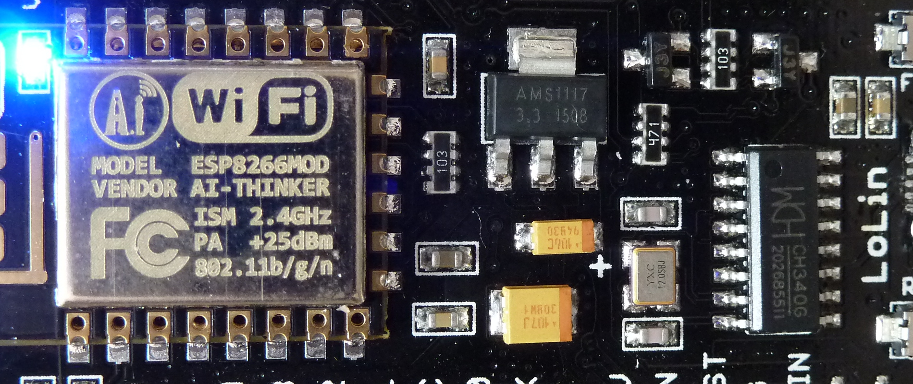

## Ceci est un test

Atelier HTML embarqué
Découvrez ce qui se cache derrière les pages web et développez des interfaces web pour vos objets connectés !

Durée : À définir (probablement 3 + 1)
Prérequis :
    • Avoir un ordinateur portable macOS, Windows ou Linux avec un OS récent.
    • Avoir installé MAMP (macOS, Windows) ou XAMPP (Linux).
1re soirée : Les éléments de base d’une page Web : HTML, CSS, JavaScript
Création d’une page statique qui nous permettra d’aborder les notions suivantes :
    • HTML : Agents utilisateurs, doctypes, XHTML vs HTML
    • CSS : CSS intégrés, CSS externes, Bootstrap
    • JavaScript : Introduction (approfondissement soirée 2)
    • Ressources externes : JSON,  XML, Images bitmap, Images vectorielles, Vidéos
2ᵉ soirée : Rendre une page dynamique
Création d’une application PHP sur le serveur MAMP ou XAMPP installé sur votre propre ordinateur et exemples de communication entre le serveur et la page Web statique créée lors de la première soirée.
    • JavaScript :  JS intégré,  JS externe,  JQuery,  JSON
    • Protocoles : HTTP, WebSocket, AJAX,  GET,  POST,  MQTT, FTP,  MAIL
    • PHP
3ᵉ soirée : Création d’une application sur ESP8266
Il y a plusieurs topologies possibles. Les deux que je connais sont :
    • L’ESP est configuré comme serveur Web. Les agents utilisateurs ne communiquent qu’avec lui. Exemple : SIMPLE-WEBSOCKET.INO.
    • L’ESP et les agents utilisateurs se connectent à un serveur externe (dans notre cas MAMP). Exemple : Station météo.

Prix 45.- pour les membres 75.- pour non membres
Conférencier : Nicolas Jeanmonod
