## Intro

Comprendre la différence entre une modulation radio et un réseau

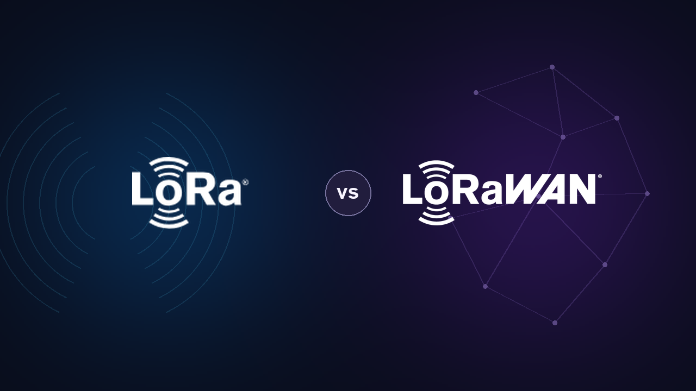

Ce texte a été réalisé pour moi, dans un premier temps, pour comprendre la différence entre les deux systèmes dont nous parlons abondamment. Dans un deuxième temps, il vous est proposé…

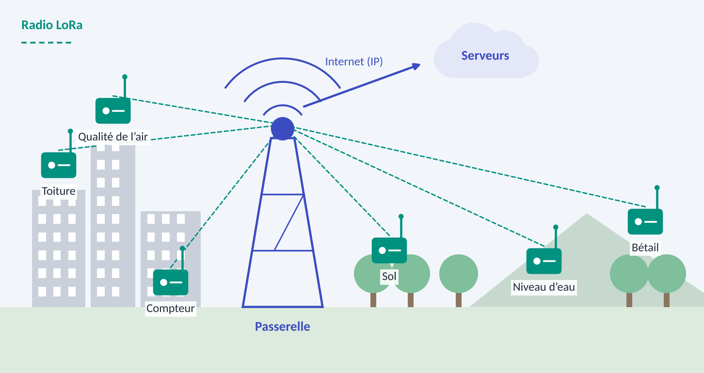

Principes, architecture, sécurité, performances et critères de choix

Jean-Pierre Broillet Novembre 2026

## L’essentiel en une page

> **La réponse courte**
>
> **LoRa est une technique de modulation radio ; LoRaWAN est un protocole et une architecture de réseau qui s’appuient sur cette modulation.**
>
> LoRa répond à la question « comment transporter des bits très loin avec très peu d’énergie ? ».
>
> LoRaWAN répond à « comment faire cohabiter des milliers d’objets sur un réseau sécurisé, administrable et interopérable ? ».

Les deux termes sont souvent employés l’un pour l’autre, alors qu’ils ne se situent pas au même niveau technique. Ils ne sont donc pas concurrents : la plupart des déploiements utilisent les deux ensemble, mais LoRa peut fonctionner sans LoRaWAN.

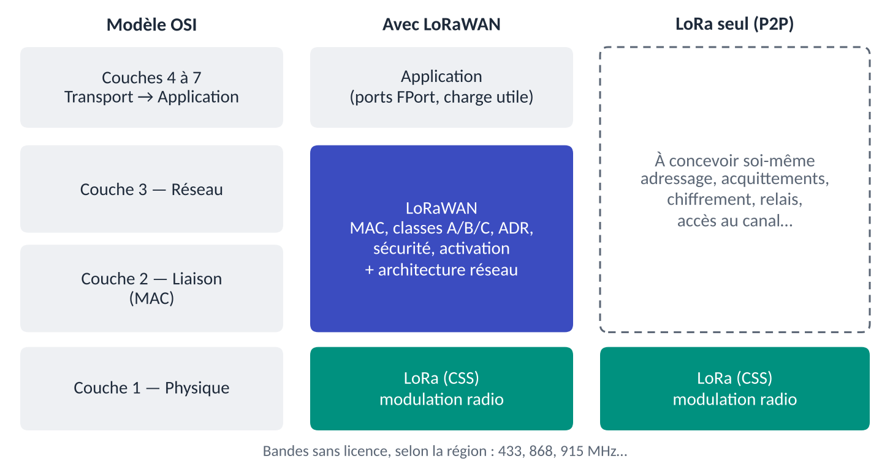

**Figure 1 —** LoRa occupe la couche physique ; LoRaWAN ajoute ce qui se trouve au-dessus. Sans LoRaWAN, ces fonctions restent à concevoir.

**Tableau 1 —** Les différences en un coup d’œil

|               | **LoRa**                            | **LoRaWAN**                                    |
| ------------- | ----------------------------------- | ---------------------------------------------- |
| **Nature**    | Modulation radio                    | Protocole MAC et architecture de réseau        |
| **Couche**    | Physique (couche 1)                 | Liaison (couche 2) et système au-dessus        |
| **Statut**    | Technologie propriétaire de Semtech | Standard ouvert de la LoRa Alliance            |
| **Topologie** | Libre : point à point, maillage…    | Étoile d’étoiles, avec passerelles et serveurs |
| **Sécurité**  | Aucune fournie : à ajouter          | AES-128, authentification et clés de session   |

> **Une analogie pour le retenir**
>
> LoRa, c’est le camion capable de rouler très loin avec peu de carburant. LoRaWAN, c’est le service postal : adresses, centres de tri, enveloppes scellées, accusés de réception et règles communes à tous les bureaux de poste.

## 1. Pourquoi cette confusion ?

Dans le langage courant, on dit « un capteur LoRa » pour désigner presque tout objet communicant de longue portée à faible consommation. Or ce raccourci recouvre des systèmes très différents : un capteur raccordé à un opérateur LoRaWAN, deux cartes qui échangent directement des paquets, ou un réseau maillé communautaire. Tous utilisent la même radio, mais pas du tout la même logique de réseau.

La distinction a des conséquences concrètes sur le choix du matériel, le niveau de sécurité, le coût d’exploitation, la possibilité de changer de fournisseur et l’effort de développement. Elle s’explique en partie par l’histoire : LoRa est issue des travaux de la société française Cycleo, rachetée par Semtech en 2012 [7]. Semtech détient la propriété intellectuelle de la couche physique, tandis que le protocole LoRaWAN est maintenu par la LoRa Alliance, association à but non lucratif [7].

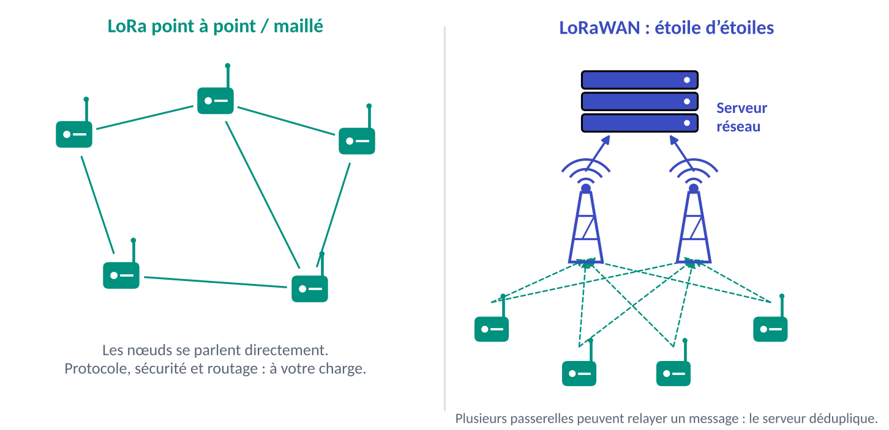

**Figure 2 —** Deux logiques de réseau à partir de la même radio : liaisons directes à gauche, passerelles et serveur à droite.

Ce document présente d’abord chaque technologie séparément, puis les compare terme à terme, chiffre l’effet concret de leurs paramètres et propose une méthode de choix. Les valeurs réglementaires et les exemples sont donnés pour le plan de fréquences européen **EU868** ; en Suisse, les prescriptions nationales de l’OFCOM restent la référence à vérifier avant tout déploiement.

## 2. LoRa : la couche physique

### 2.1 Une modulation à étalement de spectre

LoRa utilise une technique dérivée de l’étalement de spectre par chirp (Chirp Spread Spectrum, CSS) [7]. Un **chirp** est un signal dont la fréquence balaie toute la largeur de bande du canal. Là où de nombreux systèmes classiques emploient la modulation FSK, CSS conserve une faible consommation tout en augmentant la portée [6].

L’information est portée par le **point de départ** du balayage : chaque symbole commence à une fréquence décalée, puis reprend au bas de la bande une fois le sommet atteint. Le récepteur retrouve ce décalage, même lorsque le signal est nettement sous le niveau de bruit.

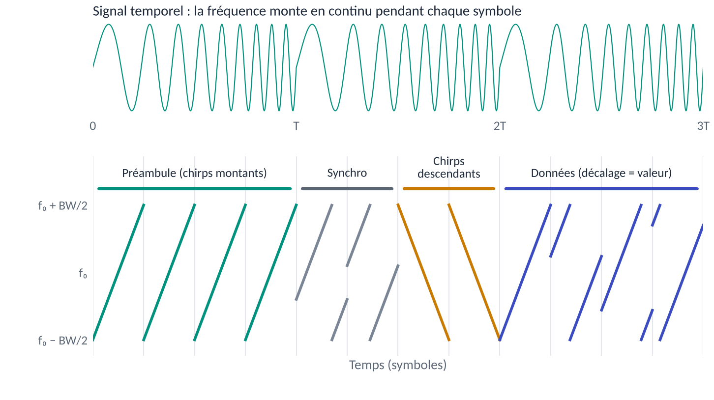

**Figure 3 —** Principe d’une transmission LoRa. Représentation temps-fréquence simplifiée : préambule, synchronisation, puis symboles de données.

### 2.2 Trois paramètres qui font tout

**Tableau 2 —** Paramètres radio de LoRa

| **Paramètre**                | **Valeurs courantes**                           | **Effet**                                                                                                                                       |
| ---------------------------- | ----------------------------------------------- | ----------------------------------------------------------------------------------------------------------------------------------------------- |
| **Facteur d’étalement (SF)** | SF7 à SF12 (SF5 et SF6 sur les radios récentes) | Chaque symbole porte SF bits et compte 2^SF chips. Un SF plus élevé améliore la sensibilité, mais double à peu près la durée de chaque symbole. |
| **Largeur de bande (BW)**    | 125, 250 ou 500 kHz                             | Plus large : débit plus élevé, sensibilité moindre.                                                                                             |
| **Taux de codage (CR)**      | 4/5 à 4/8                                       | Ajoute de la redondance pour corriger les erreurs, au prix d’une trame plus longue.                                                             |

La durée d’un symbole vaut **Ts = 2^SF / BW**. À 125 kHz, elle passe de 1,024 ms en SF7 à 32,768 ms en SF12. Ce temps supplémentaire laisse au récepteur plus d’énergie à accumuler par symbole : c’est le mécanisme qui transforme de la lenteur en portée.

![Le compromis du facteur d’étalement à 125 kHz. Débits EU868 [3] ; temps d’émission et bilan de liaison calculés (hypothèses au chapitre 5).](images/le-compromis-du-facteur-detalement-a-125-khz-deb.png)

**Figure 4 —** Le compromis du facteur d’étalement à 125 kHz. Débits EU868 [3] ; temps d’émission et bilan de liaison calculés (hypothèses au chapitre 5).

### 2.3 Bilan de liaison et portée

La sensibilité théorique se calcule par **S = −174 + 10·log₁₀(BW) + NF + SNR**. Avec un facteur de bruit de 6 dB, on obtient environ −124,5 dBm en SF7 et −137 dBm en SF12 à 125 kHz. Pour une puissance d’émission de +14 dBm, le bilan de liaison atteint donc près de 151 dB en SF12.

En pratique, la portée dépend surtout du dégagement radio et de la hauteur des antennes. L’ordre de grandeur habituellement observé est de quelques kilomètres en ville et de 10 à 15 km ou davantage en terrain dégagé ; une visibilité directe exceptionnelle permet bien plus. Seule une campagne de mesure sur site donne une valeur fiable.

### 2.4 Ce que LoRa ne fait pas

LoRa définit la forme d’onde et la structure d’un paquet radio : préambule, en-tête optionnel, charge utile et CRC. Elle ne fournit en revanche aucun des services suivants :

-   l’identification et l’adressage des appareils ;
-   l’authentification et le chiffrement ;
-   la gestion de l’accès au canal, les retransmissions et les acquittements ;
-   le routage vers une application, le roaming et l’adaptation automatique du débit.

Toutes ces fonctions doivent être apportées par une couche supérieure. LoRaWAN en est la plus répandue, mais pas la seule.

## 3. LoRaWAN : le réseau

### 3.1 Architecture en étoile d’étoiles

LoRaWAN définit le protocole de communication et l’architecture du système [7]. Selon l’analyse de RCR Wireless, ce niveau détermine le plus fortement l’autonomie des nœuds, la capacité du réseau, la qualité de service et la sécurité [6].

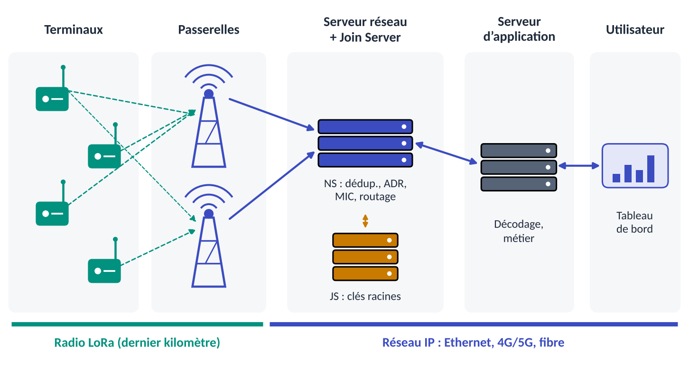

**Figure 5 —** Architecture LoRaWAN : un même terminal peut être entendu par plusieurs passerelles, qui relaient ses trames vers le serveur réseau.

**Tableau 3 —** Rôle de chaque composant

| **Composant**             | **Rôle**                                                                                                                      |
| ------------------------- | ----------------------------------------------------------------------------------------------------------------------------- |
| **Terminal**              | Capteur ou actionneur. Il émet sans être associé à une passerelle donnée.                                                     |
| **Passerelle**            | Pont entre radio et IP. Elle écoute plusieurs canaux en parallèle, souvent 8, sans interpréter le contenu des trames.         |
| **Serveur réseau**        | Vérifie l’intégrité, élimine les doublons, pilote le débit adaptatif (ADR) et choisit la passerelle pour la voie descendante. |
| **Join Server**           | Conserve les clés racines et gère l’activation OTAA.                                                                          |
| **Serveur d’application** | Déchiffre et exploite les données, puis les transmet aux systèmes métier.                                                     |

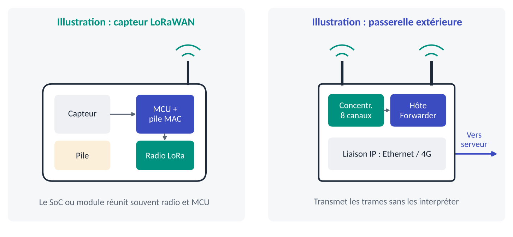

**Figure 6 —** Schémas de principe d’un capteur et d’une passerelle : la radio LoRa est un composant parmi d’autres dans chaque équipement.

### 3.2 Trois classes de terminaux

La spécification définit trois comportements. Tous les terminaux doivent implémenter la classe A ; les classes B et C l’étendent [13]. Le choix arbitre entre autonomie et capacité à recevoir rapidement un ordre.

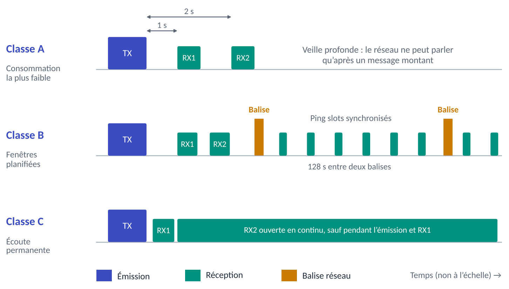

**Figure 7 —** Fenêtres de réception des classes A, B et C. Délais par défaut pour RX1 et RX2 ; chronologie non à l’échelle.

**Tableau 4 —** Comparaison des classes

| **Classe** | **Réception**                                     | **Consommation** | **Usage typique**                         |
| ---------- | ------------------------------------------------- | ---------------- | ----------------------------------------- |
| **A**      | Deux fenêtres brèves après chaque émission        | La plus faible   | Capteurs sur pile : compteurs, sondes     |
| **B**      | Fenêtres supplémentaires synchronisées par balise | Intermédiaire    | Actionneurs sur pile, avec latence bornée |
| **C**      | Écoute quasi permanente                           | La plus élevée   | Équipements alimentés : éclairage, relais |

### 3.3 Activation : OTAA ou ABP

**OTAA** (Over-The-Air Activation) est la méthode recommandée : le terminal négocie sa connexion et des clés de session propres sont régénérées à chaque activation [4][5]. **ABP** (Activation By Personalization) inscrit directement l’adresse et les clés de session dans l’appareil. Plus simple, elle laisse ces clés inchangées jusqu’à une modification manuelle et présente des faiblesses [4][5].

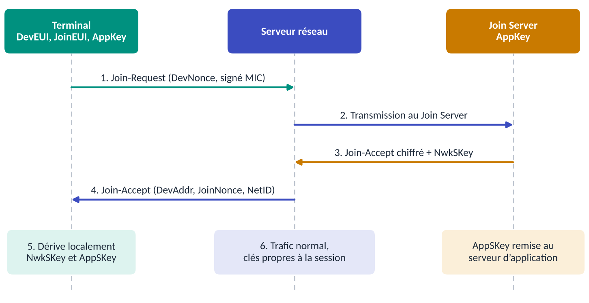

**Figure 8 —** Activation OTAA simplifiée. En LoRaWAN 1.0.x, la clé racine est l’AppKey ; la version 1.1 ajoute une NwkKey distincte.

### 3.4 Sécurité à deux niveaux

LoRaWAN s’appuie sur AES-128 [4]. Le point essentiel est la **séparation des rôles** : la NwkSKey protège l’intégrité des trames côté réseau, tandis que l’AppSKey chiffre les données. L’opérateur peut ainsi acheminer un message sans pouvoir en lire le contenu [5]. Un compteur de trames rejette en outre les messages rejoués [4].

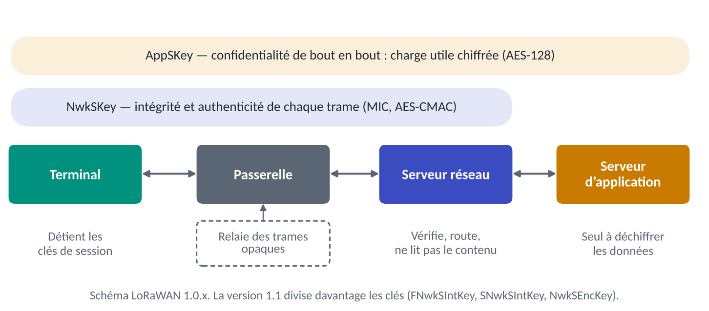

**Figure 9 —** Deux clés de session, deux périmètres : le réseau vérifie les trames, seule l’application accède aux données.

> **Point de vigilance**
>
> Cette protection dépend de la gestion des clés. Une AppSKey confiée à l’opérateur, des clés extraites d’un appareil ou une mauvaise gestion des compteurs en ABP annulent une partie de ces garanties. Des travaux de recherche documentent des attaques possibles sur les versions 1.0 et 1.1, en OTAA comme en ABP [17].

### 3.5 Format d’une trame

LoRaWAN s’insère dans la charge utile d’un paquet LoRa. Cette imbrication illustre concrètement la relation entre les deux technologies : **une trame LoRaWAN est transportée à l’intérieur d’un paquet LoRa**.

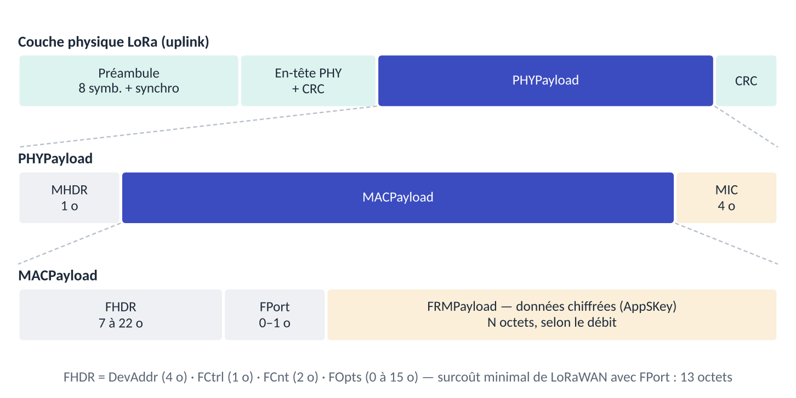

**Figure 10 —** Encapsulation d’une trame LoRaWAN montante dans un paquet LoRa.

### 3.6 Paramètres régionaux EU868

LoRaWAN encadre aussi l’usage du spectre selon les régions. En Europe, trois canaux sont obligatoires, à 868,1, 868,3 et 868,5 MHz [3]. La deuxième fenêtre de réception utilise par défaut 869,525 MHz en SF12 [3][12]. Les limites de rapport cyclique varient selon la sous-bande [11].

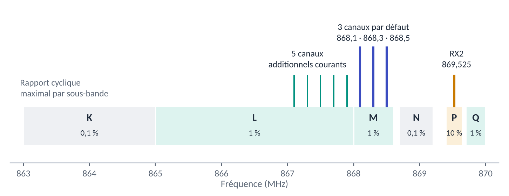

**Figure 11 —** Sous-bandes de la bande 863-870 MHz, rapport cyclique maximal et canaux LoRaWAN usuels.

**Tableau 5 —** Débits LoRaWAN EU868 sur 125 kHz

| **DR**  | **Configuration** | **Débit indicatif** | **Charge applicative max.** |
| ------- | ----------------- | ------------------- | --------------------------- |
| **DR0** | SF12 / 125 kHz    | 250 bit/s           | 51 octets                   |
| **DR1** | SF11 / 125 kHz    | 440 bit/s           | 51 octets                   |
| **DR2** | SF10 / 125 kHz    | 980 bit/s           | 51 octets                   |
| **DR3** | SF9 / 125 kHz     | 1 760 bit/s         | 115 octets                  |
| **DR4** | SF8 / 125 kHz     | 3 125 bit/s         | 242 octets                  |
| **DR5** | SF7 / 125 kHz     | 5 470 bit/s         | 242 octets                  |

Le protocole définit également DR6 (SF7 / 250 kHz), DR7 (FSK à 50 kbit/s) et, en option, DR8 à DR11 en LR-FHSS [3]. Cela montre une nuance importante : **LoRaWAN n’est pas strictement limité à la modulation LoRa**. Le mécanisme **ADR**, géré par le serveur réseau, sélectionne le débit optimal pour chaque terminal [8].

## 4. Comparaison détaillée

**Tableau 6 —** LoRa et LoRaWAN, critère par critère

| **Critère**                 | **LoRa**                                                | **LoRaWAN**                                                            |
| --------------------------- | ------------------------------------------------------- | ---------------------------------------------------------------------- |
| **Définition**              | Modulation radio longue portée                          | Protocole de communication et architecture de réseau                   |
| **Niveau OSI**              | Couche physique                                         | Couche liaison (MAC), complétée par une architecture de système        |
| **Détenteur**               | Semtech (technologie propriétaire)                      | LoRa Alliance (standard ouvert)                                        |
| **Rôle**                    | Transformer des bits en signal radio                    | Gérer identité, accès, sécurité et acheminement                        |
| **Topologie**               | Point à point, étoile ou maillage, à concevoir          | Étoile d’étoiles normalisée                                            |
| **Infrastructure**          | Deux radios suffisent                                   | Passerelles et serveurs, ou opérateur                                  |
| **Adressage**               | Aucun : à définir                                       | DevEUI, DevAddr, JoinEUI                                               |
| **Sécurité**                | Aucune en natif                                         | AES-128, MIC, clés de session, protection anti-rejeu                   |
| **Accès au canal**          | Non défini                                              | Type ALOHA, avec règles régionales                                     |
| **Débit**                   | SF, BW et CR réglés librement                           | Débits normalisés, ADR                                                 |
| **Fiabilité**               | À implémenter                                           | Trames confirmées et retransmissions                                   |
| **Bandes**                  | Sous-GHz et 2,4 GHz                                     | Sous-GHz selon plans régionaux ; pas de spécification à 2,4 GHz [14]   |
| **Interopérabilité**        | Propre à chaque implémentation                          | Certification LoRaWAN et réseaux multifournisseurs                     |
| **Effort de développement** | Démarrage simple, mais tout le protocole reste à écrire | Pile logicielle et réseau existants, davantage de concepts à maîtriser |

> **Comment lire ce tableau**
>
> La colonne LoRa décrit ce que fournit la radio seule : « à définir » ne signifie pas « impossible », mais « à votre charge ». La colonne LoRaWAN décrit ce que le standard apporte d’emblée, avec les contraintes qui l’accompagnent.

## 5. L’impact en chiffres

### 5.1 Temps d’émission et rapport cyclique

Exemple : un capteur envoie **10 octets applicatifs**. LoRaWAN ajoute au minimum 13 octets (en-tête, port et MIC), soit 23 octets de charge PHY. Le calcul applique la formule de temps d’émission publiée par Semtech, avec préambule de 8 symboles, en-tête explicite, CRC et CR 4/5.

**Tableau 7 —** Temps d’émission pour 23 octets PHY à 125 kHz et limite de 1 %

| **SF**   | **Symbole (ms)** | **Émission (ms)** | **Sensibilité (dBm)** | **Attente mini (s)** | **Messages max./h** |
| -------- | ---------------- | ----------------- | --------------------- | -------------------- | ------------------- |
| **SF7**  | 1,02             | 61,7              | −124,5                | 6,1                  | 583                 |
| **SF8**  | 2,05             | 113,2             | −127,0                | 11,2                 | 318                 |
| **SF9**  | 4,10             | 205,8             | −129,5                | 20,4                 | 174                 |
| **SF10** | 8,19             | 370,7             | −132,0                | 36,7                 | 97                  |
| **SF11** | 16,38            | 823,3             | −134,5                | 81,5                 | 43                  |
| **SF12** | 32,77            | 1482,8            | −137,0                | 146,8                | 24                  |

En passant de SF7 à SF12, le temps d’émission est multiplié par environ **24**. L’énergie radio à l’émission suit à peu près la même proportion, tout comme l’occupation du canal. Un SF élevé n’est donc pas gratuit : il réduit l’autonomie et la capacité partagée du réseau.

> **Application : un message toutes les 15 minutes**
>
> Soit 96 messages par jour. En SF7, le capteur émet 5,9 s par jour, et en SF12 142,3 s par jour. Dans les deux cas, on reste très sous la limite réglementaire de 1 % (864 s par jour). Attention : sur un réseau communautaire ou opérateur, des règles d’usage plus strictes peuvent s’appliquer.

### 5.2 Le coût du protocole

Le surcoût de LoRaWAN se mesure directement. Pour les mêmes 10 octets, un paquet LoRa brut est plus court, mais il ne contient ni adresse, ni contrôle d’intégrité cryptographique, ni chiffrement.

**Tableau 8 —** LoRa brut comparé à LoRaWAN, pour 10 octets utiles

| **Facteur** | **LoRa brut (10 o)** | **LoRaWAN (23 o)** | **Surcoût** |
| ----------- | -------------------- | ------------------ | ----------- |
| **SF7**     | 41,2 ms              | 61,7 ms            | \+ 50 %     |
| **SF12**    | 991,2 ms             | 1 482,8 ms         | \+ 50 %     |

Ce surcoût est le prix d’un réseau sécurisé et partagé. Un protocole propriétaire équivalent devrait, lui aussi, transporter une adresse, une intégrité et un compteur.

## 6. Quel choix pour quel projet ?

### 6.1 LoRa sans LoRaWAN

LoRaWAN n’est pas obligatoire pour utiliser LoRa [14]. Plusieurs familles d’usages reposent sur la couche physique seule :

-   **Liaison point à point (P2P)** : commande d’un portail ou télémétrie entre deux sites, avec un protocole minimal.
-   **Maillage** : Meshtastic relaie les messages entre nœuds, sans le modèle en étoile de LoRaWAN [15].
-   **LoRa à 2,4 GHz** : possible avec des circuits dédiés, mais sans spécification LoRaWAN pour cette bande [14].

### 6.2 Méthode de décision

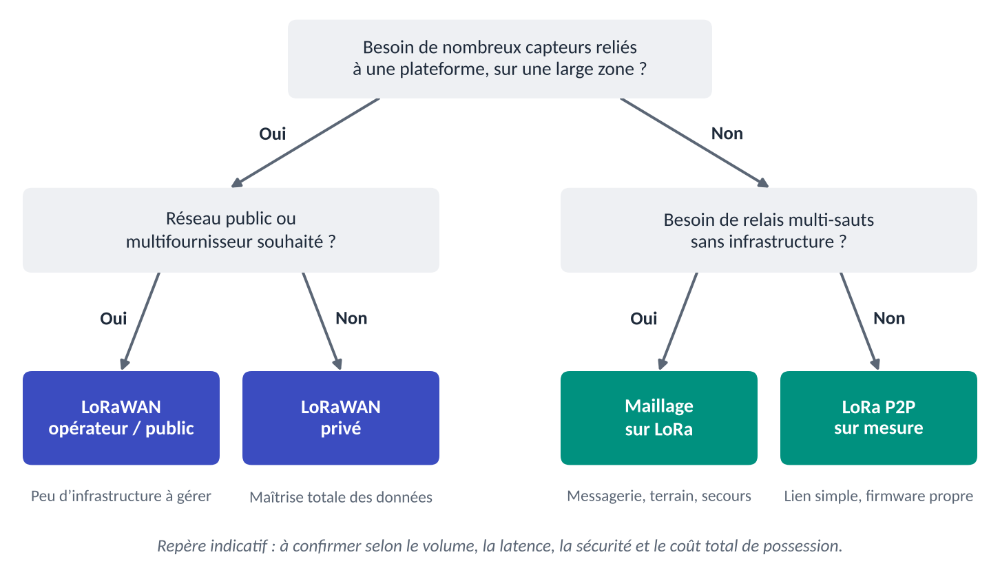

**Figure 12 —** Arbre de décision simplifié pour orienter le choix.

**Tableau 9 —** Exemples d’usages

| **Besoin**                              | **Solution adaptée** | **Raison principale**                           |
| --------------------------------------- | -------------------- | ----------------------------------------------- |
| Compteurs d’eau à l’échelle d’une ville | LoRaWAN              | Volume, autonomie, exploitation à long terme    |
| Campus ou usine avec données sensibles  | LoRaWAN privé        | Maîtrise de l’infrastructure et standard ouvert |
| Capteurs dispersés sur le territoire    | LoRaWAN opérateur    | Aucune passerelle à exploiter                   |
| Commande d’une pompe à 2 km             | LoRa P2P             | Deux équipements, aucun serveur                 |
| Communication d’une équipe hors réseau  | Maillage LoRa        | Sans infrastructure, relais entre nœuds         |

## 7. Limites et évolutions récentes

### 7.1 Limites communes

-   **Débit faible** : ni voix, ni vidéo, ni transfert de fichiers volumineux dans un usage courant.
-   **Spectre partagé** : les bandes sans licence n’offrent aucune garantie contre les interférences.
-   **Voie descendante limitée** en LoRaWAN : une passerelle est soumise elle aussi au rapport cyclique et ne peut pas écouter pendant qu’elle émet.
-   **Latence** : la classe A ne reçoit qu’après une émission du terminal.
-   **Collisions** : l’accès de type ALOHA pénalise les réseaux chargés.

### 7.2 État des lieux

La spécification de référence de la couche liaison reste, selon la documentation Semtech consultée, **TS001-1.0.4**, publiée en octobre 2020 [1][2]. LoRaWAN est également reconnu par l’UIT (recommandation UIT-T Y.4480) [18].

-   **Adoption** : la LoRa Alliance annonçait 125 millions de terminaux déployés fin 2025, avec une croissance annuelle composée de 25 %, et 360 membres [9]. ARC Advisory Group a relayé depuis un chiffre de 150 millions pour 2026 [10].
-   **Débits accrus** : la spécification RP2-1.0.5 (novembre 2025) ajoute des débits en SF5 et SF6, à 15,6 et 9,4 kbit/s bruts [8]. La LoRa Alliance indique une baisse d’au moins 50 % de l’énergie de transmission pour un capteur intérieur typique [8].
-   **LR-FHSS** : ces débits optionnels augmentent la capacité dans certains scénarios et ouvrent la voie à la connexion directe par satellite [16].
-   **Satellite** : des opérateurs comme Lacuna Space et Plan-S proposent déjà des services LoRaWAN en orbite basse [18].

> **Conclusion**
>
> LoRa et LoRaWAN ne s’opposent pas : ils se superposent. **LoRa apporte la portée et la sobriété ; LoRaWAN apporte le réseau, la sécurité et l’interopérabilité.** Pour un parc de capteurs destiné à durer, LoRaWAN est généralement le choix naturel. LoRa seule se justifie pour un lien simple, un maillage ou un protocole spécifique, à condition d’assumer soi-même ce que LoRaWAN aurait fourni.

## Glossaire

**Tableau 10 —** Termes et abréviations

| **Terme**      | **Signification**                                                  |
| -------------- | ------------------------------------------------------------------ |
| **ABP**        | Activation By Personalization : activation avec clés préinstallées |
| **ADR**        | Adaptive Data Rate : adaptation du débit pilotée par le réseau     |
| **AES-128**    | Algorithme de chiffrement symétrique à clé de 128 bits             |
| **AppSKey**    | Clé de session pour le chiffrement des données applicatives        |
| **BW**         | Bandwidth : largeur de bande du canal                              |
| **CR**         | Coding Rate : taux de codage correcteur                            |
| **CSS**        | Chirp Spread Spectrum : étalement de spectre par chirp             |
| **DevEUI**     | Identifiant unique mondial d’un terminal                           |
| **DR**         | Data Rate : combinaison normalisée de paramètres radio             |
| **Duty cycle** | Rapport cyclique : part maximale du temps d’émission               |
| **LPWAN**      | Low-Power Wide-Area Network : réseau étendu à basse consommation   |
| **MAC**        | Medium Access Control : contrôle d’accès au support                |
| **MIC**        | Message Integrity Code : code d’intégrité d’une trame              |
| **NwkSKey**    | Clé de session pour l’intégrité côté réseau                        |
| **OTAA**       | Over-The-Air Activation : activation par échange radio             |
| **P2P**        | Peer-to-Peer : communication directe entre équipements             |
| **RX1 / RX2**  | Première et seconde fenêtres de réception après une émission       |
| **SF**         | Spreading Factor : facteur d’étalement                             |

P.S. Les remarques constructives seront prises en compte, et le cas échéant, intégrées à ce billet.

## Sources

Sources consultées en novembre 2026. Les calculs de temps d’émission et de sensibilité sont réalisés pour ce document à partir de formules publiques ; ils constituent des valeurs théoriques.

1. [Semtech Learning Center, spécification LoRaWAN actuelle](https://learn.semtech.com/mod/page/view.php?id=26)
2. [LoRa Alliance, LoRaWAN 1.0.4 Specification Package](https://lora-alliance.org/?p=5965)
3. [The Things Network, EU863-870 MHz Band](https://www.thethingsnetwork.org/docs/lorawan/regional-parameters/eu868/)
4. [The Things Network, Security](https://www.thethingsnetwork.org/docs/lorawan/security/index.html)
5. [The Things Network, Certified Security](https://www.thethingsnetwork.org/docs/lorawan/the-things-certified-security/)
6. [RCR Wireless, What’s the difference between LoRa and LoRaWAN?](https://rcrwireless.com/20180516/fundamentals/the-difference-between-lora-and-lorawan-tag40-tag99)
7. [Actility, What are LoRa and LoRaWAN?](https://www.actility.com/what-is-lora-and-lorawan/)
8. [LoRa Alliance, communiqué RP2-1.0.5](https://lora-alliance.org/lora-alliance-press-release/lora-alliance-met-a-jour-les-parametres-regionaux-lorawan-pour-ameliorer-les-performances-iot-dans-les-villes-intelligentes-les-batiments-les-habitations-lindustrie-et-la-logistique/)
9. [LoRa Alliance, rapport de fin d’année 2025](https://resources.lora-alliance.org/home/lorawan-enters-its-next-growth-phase-as-massive-iot-scales-globally)
10. [ARC Advisory Group, 150 Million LoRaWAN Devices](https://www.arcweb.com/node/164156)
11. [Guide des sous-bandes EU868](https://edgepilot-website.pages.dev/news/lorawan-frequency-bands-europe-eu868-guide)
12. [The Things Network, Regional Limitations of RF Use](https://www.thethingsnetwork.org/docs/lorawan/regional-limitations-of-rf-use/)
13. [Akenza, documentation LoRaWAN (classes)](https://docs.akenza.io/api-reference/lorawan)
14. [V. Prajzler, Using LoRa without LoRaWAN](https://medium.com/@prajzler/using-lora-without-lorawan-48dfeefed4d2)
15. [LWN.net, Meshtastic](https://lwn.net/Articles/1009782)
16. [LoRa Alliance, RP2-1.0.2 et LR-FHSS](https://lora-alliance.org/?p=9973)
17. [Sécurité LoRaWAN : article scientifique (SciTePress, 2020)](https://www.scitepress.org/Papers/2020/95611/95611.pdf)
18. [Network World (republication), LoRaWAN reaches 125 million devices](https://longform.social/post/did:plc:qzjwstutqk2cy7df7jbzd2hx/3mfbbf5wvga32)

LoRa®, LoRaWAN® et LoRa Alliance® sont des marques déposées de leurs titulaires respectifs. Les schémas et illustrations ont été créés pour ce document.
